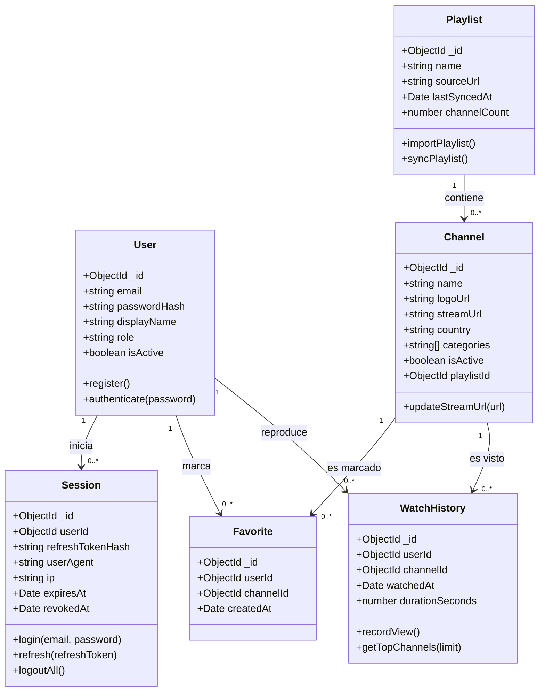

# 02 · Componentes y modelo de dominio

TV Hub sigue el patrón **MVC**: cada componente tiene un **modelo** (Mongoose/DocumentDB), un
**controlador** con la lógica de negocio y **rutas REST** propias bajo `/api`.

## Componentes (6 entidades)

| Componente | Responsabilidad | Campos clave |
|------------|-----------------|--------------|
| **Users** | Registro y administración de cuentas | `email`, `passwordHash`, `displayName`, `role` (`user`/`admin`), `isActive` |
| **Sessions** | Control de sesiones y tokens de refresco | `userId`, `refreshTokenHash`, `userAgent`, `ip`, `expiresAt`, `revokedAt` |
| **Channels** | Canales disponibles para reproducción | `name`, `logoUrl`, `streamUrl`, `country`, `categories`, `isActive`, `playlistId` |
| **Playlists** | Listas M3U importadas y su sincronización | `name`, `sourceUrl`, `lastSyncedAt`, `channelCount` |
| **Favorites** | Canales marcados por usuario | `userId`, `channelId`, `createdAt` |
| **WatchHistory** | Historial de reproducción por usuario | `userId`, `channelId`, `watchedAt`, `durationSeconds` |

### Métodos

| Clase | Método | Descripción |
|-------|--------|-------------|
| `Playlist` | `importPlaylist` | Descarga y parsea una lista M3U y crea los canales |
| `Playlist` | `syncPlaylist` | Re-sincroniza la lista **sin duplicar** canales existentes (upsert por clave) |
| `Session` | `login` | Valida credenciales y emite access token + refresh token |
| `Session` | `refresh` | **Rota** el refresh token: invalida el anterior y emite uno nuevo |
| `Session` | `logoutAll` | Revoca todas las sesiones activas del usuario |
| `WatchHistory` | `recordView` | Registra una reproducción del usuario sobre un canal |
| `WatchHistory` | `getTopChannels` | Devuelve los canales más vistos (endpoint `/api/history/top`) |

## API REST (~20 endpoints)

| Prefijo | Endpoints | Notas |
|---------|-----------|-------|
| `/api/auth` | `register`, `login`, `refresh`, `logout`, `logout-all` | JWT + refresh rotativo en cookie HttpOnly |
| `/api/users` | `list`, `get`, `update`, `delete` (admin) | CRUD de usuarios |
| `/api/channels` | `list` (filtros por nombre/país/categoría), `get`, `create`, `update`, `delete` | CRUD de canales |
| `/api/playlists` | `list`, `get`, `create`, `update`, `delete`, `sync` | Importación y re-sincronización M3U |
| `/api/favorites` | `list`, `add`, `remove` | Favoritos del usuario autenticado |
| `/api/history` | `list`, `record`, `top` | Historial y canales más vistos |
| `/health`, `/ready` | liveness / readiness | Requeridos por Kubernetes (probes de EKS) |

## Seguridad

- Contraseñas con **bcryptjs** (hash + salt).
- **JWT** de acceso de corta duración + **refresh token rotativo** en cookie `HttpOnly`, `Secure`,
  `SameSite`.
- Control por rol (`user` / `admin`) en rutas administrativas.
- Secrets (cadena de conexión a DocumentDB, `JWT_SECRET`) inyectados desde Kubernetes Secrets, nunca en el
  código ni en el repositorio.

## Diagrama de clases

## Modelo de persistencia

Cada entidad es un **modelo Mongoose** (un `Schema` por colección) con índices para los accesos frecuentes
(búsqueda por nombre/país, favoritos únicos por `userId + channelId`, historial por `userId + watchedAt`).
La base de datos es **Amazon DocumentDB**, compatible con la API de MongoDB; las consideraciones de
compatibilidad se describen en [`03-stack.md`](03-stack.md).
