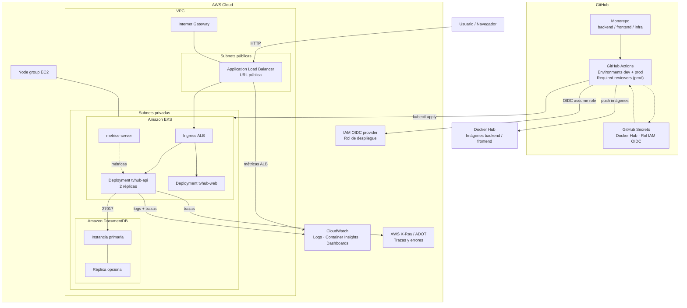

# 04 · Infraestructura AWS

Toda la infraestructura se define como código en `/infra` con **Terraform** (sin crear recursos a mano).
Este documento enumera **qué recursos se van a crear** y cómo se relacionan.

## Recursos AWS que se van a crear

### Red (VPC)

- **VPC** dedicada al proyecto (por ejemplo, `10.0.0.0/16`).
- **Subnets públicas** (2–3 AZ) para el ALB y la NAT.
- **Subnets privadas** (2–3 AZ) para los nodos de EKS y DocumentDB.
- **Internet Gateway** y **NAT Gateway** (salida de los nodos privados).
- **Route tables** públicas/privadas.
- **Security Groups**: ALB ↔ nodos, nodos ↔ DocumentDB, nodos ↔ Internet.

### Cómputo — Amazon EKS

- **Cluster EKS** con endpoint de API.
- **Node group gestionado** (EC2, por ejemplo `t3.medium`) en subnets privadas, con `min/desired/max`
  configurables.
- **Rol IAM del cluster** y **rol IAM de los nodos** con las políticas mínimas.
- **IAM OIDC provider** del cluster (para roles IRSA de service accounts y para el *service account* del
  AWS Load Balancer Controller).
- **Addons**: `aws-ebs-csi-driver`, `coredns`, `kube-proxy`, `vpc-cni`; **metrics-server** instalado (HPA 2→5 pendiente en `TVH-25`).
- **AWS Load Balancer Controller** (Pod Identity) que crea el **ALB** directamente a partir del **Ingress** (`ingressClassName: alb`).
- **Namespaces**: `dev` y `prod` (aislamiento de ambientes en el mismo clúster).
- **Deployments + Services**: `tvhub-api` (backend) y `tvhub-web` (frontend).
- **Ingress ALB** → **ALB** con **URL pública** (HTTP:80) por ambiente.
- **Réplicas** del backend/frontend: 2 réplicas por ambiente (`TVH-25` para HPA queda abierto).
- **Kubernetes Secrets** con la cadena de conexión de DocumentDB y `JWT_SECRET`.
- **imagePullSecrets** con las credenciales de Docker Hub.

### Base de datos — Amazon DocumentDB

- **Cluster DocumentDB** (1 instancia primaria, opcional réplica) en subnets privadas.
- **Subnet group** de DocumentDB.
- **Security Group** de DocumentDB: solo permite el puerto 27017 desde el Security Group de los nodos.
- **Credenciales** (usuario/contraseña) almacenadas en Secrets, nunca en el repositorio.

### Seguridad e identidad

- **Rol IAM de despliegue** asumible por **GitHub Actions vía OIDC** (equivalente al *service connection*
  de Azure DevOps): permite `kubectl`/`helm` sobre el cluster sin claves estáticas.
- **GitHub Environments** `dev` y `prod` con **required reviewers** para Prod.
- **GitHub Secrets**: credenciales de Docker Hub, ARN del rol, configuración del cluster.

### Observabilidad

- **CloudWatch Container Insights** (métricas de CPU, memoria, red por pod/nodo).
- **CloudWatch Logs** con grupo por ambiente/servicio.
- **AWS X-Ray / ADOT (OpenTelemetry)** para trazas, errores y mensajes de la API.
- **Métricas del ALB** (requests, 4xx/5xx) y **dashboard `tvhub-dev`** de CloudWatch con CPU / memoria /
  requests.

> **Alternativa de frontend:** mantenido en EKS (Deployment + Service detrás del Ingress). Como alternativa
> evaluada, se podría servir desde **S3 + CloudFront**; se descarta para la demo por simplicidad.

## Diagrama de infraestructura

## Ambientes

| Ambiente | Namespace EKS | Ingreso | Aprobación |
|----------|---------------|---------|------------|
| **Dev** | `dev` | URL pública (ALB) de Dev | **Automático tras el merge a `main`** |
| **Prod** | `prod` | URL pública (ALB) de Prod | **Required reviewers** + aprobación manual |

## Siguientes pasos

Ver [`05-deployment.md`](05-deployment.md) para el flujo de CI/CD y [`06-estrategia-ramas.md`](06-estrategia-ramas.md) para el modelo de ramas.
