# 05 · Deployment y CI/CD

## Modelo de entrega

- **Monorepo** en GitHub con tres carpetas: `/backend`, `/frontend`, `/infra`.
- Cada cambio entra por una **rama corta** (`feature/*`, `fix/*`, `infra/*`) y un **Pull Request** revisado.
- **Dev** se despliega **solo tras el merge a `main`** (no en el PR): **GitHub Actions** construye, ejecuta
  las **pruebas unitarias** con **cobertura ≥ 80%**, publica la imagen en **Docker Hub** y despliega en **Dev**
  de forma **automática**.
- El paso a **Prod** requiere **aprobación manual** (*required reviewers* del GitHub Environment `prod`).
- El **backlog** vive en **GitHub Projects** y los cambios se enlazan a issues.

## Etapas del pipeline

### Backend (`/backend`)

1. **CI / Build**: instalar dependencias, compilar TypeScript, lints.
2. **Pruebas unitarias**: `jest` + `supertest`, cobertura **≥ 80% bloqueante**; publica `lcov` y JUnit como
   artefactos.
3. **Docker build**: imagen multi-stage → **Docker Hub** (`tvhub-api`).
4. **Deploy Dev**: `kubectl`/`helm` al namespace `dev` de EKS.
5. **Aprobación**: *required reviewers* del Environment `prod`.
6. **Deploy Prod**: `kubectl`/`helm` al namespace `prod` → **URL pública** detrás del ALB.

### Frontend (`/frontend`)

1. Validaciones estáticas / pruebas (si aplica).
2. **Docker build** → Docker Hub.
3. **Deploy Dev** y **Deploy Prod** (mismo esquema de aprobación).

### Infraestructura (`/infra`)

1. `terraform fmt -check` y `terraform validate`.
2. `terraform plan` en PR (revisión).
3. `terraform apply` en `main` (con aprobación para cambios sensibles).

## Autenticación de despliegue

- GitHub Actions asume un **rol IAM vía OIDC** (sin claves estáticas); equivale al *service connection*.
- Credenciales de Docker Hub en **GitHub Secrets**.
- Acceso a DocumentDB solo desde los nodos (Security Group), con credenciales en **Kubernetes Secrets**.

## Diagrama de deployment / CI-CD

```mermaid
flowchart LR
    dev_["Desarrollador"] --> branch["Rama feature/fix/infra"]
    branch -->|push| pr["Pull Request"]
    pr -->|revisión + aprobación| main["main protegida<br/>merge"]

    subgraph actions["GitHub Actions"]
        build["Build + lint"]
        test["Pruebas unitarias<br/>cobertura >= 80%"]
        img["Docker build<br/>multi-stage"]
        art["Artefactos<br/>lcov · JUnit"]
    end

    subgraph hub["Docker Hub"]
        registry["tvhub-api<br/>tvhub-web"]
    end

    subgraph eks["Amazon EKS"]
        devns["Namespace dev"]
        prodns["Namespace prod"]
    end

    subgraph gate["GitHub Environment prod"]
        approve["Required reviewers<br/>aprobación manual"]
    end

    main -->|merge a main| actions
    build --> test
    test --> art
    test -->|pasa| img
    img --> registry
    registry --> devns
    devns -->|URL pública Dev| check["Verificación manual<br/>en Dev"]
    check --> approve
    approve -->|aprobado| prodns
    prodns -->|URL pública Prod| final["Cambio visible<br/>en Prod"]

    devns --> obs["CloudWatch / X-Ray<br/>logs · trazas · métricas"]
    prodns --> obs
```

## Ambientes

| Ambiente | Namespace | Despliegue | URL |
|----------|-----------|------------|-----|
| **Dev** | `dev` | Automático **tras el merge a `main`** (build + pruebas unitarias + cobertura → Dev) | URL del ALB de Dev |
| **Prod** | `prod` | Tras aprobación de *required reviewers* | URL del ALB de Prod |

## Notas de seguridad

- No se commitean secretos; todo va en **GitHub Secrets** / **Kubernetes Secrets**.
- Las imágenes se etiquetan con el **SHA del commit** (immutables) además de `latest` para reintentos seguros.
- Rollback: `kubectl rollout undo` sobre el Deployment del ambiente, sin re-desplegar infraestructura.
